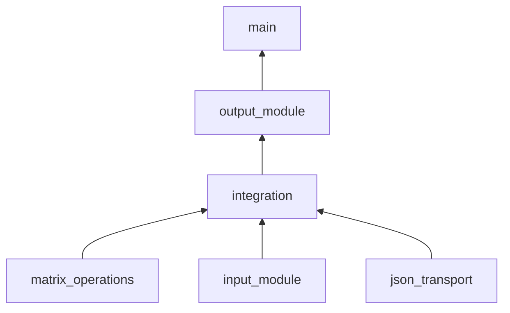

# Интеграция модулей

## Назначение

Интегрированная система сохраняет предметную область ЛР №1 и ЛР №2: обмен
элементов главной и побочной диагоналей квадратной матрицы. В соответствии с
вариантом 14 применяется восходящая стратегия интеграции и обмен через
JSON-файлы.

## Состав модулей

- `matrix_operations.py` проверяет матрицу и выполняет оба преобразования;
- `input_module.py` считывает данные и формирует запрос версии 1.0;
- `json_transport.py` читает и атомарно записывает JSON-файлы;
- `integration.py` проверяет контракт и связывает обработку с транспортом;
- `output_module.py` форматирует успешные ответы и сообщения об ошибках;
- `main.py` управляет интерактивным и файловым режимами.

## Восходящая стратегия

Сначала автономно проверяется нижний модуль операций с помощью
`tools/processing_driver.py`. Затем к нему подключаются проверка запроса и
JSON-транспорт. Последним подключается управляющий модуль. Такой порядок
уменьшает риск: математические операции проверены до добавления ввода-вывода.



## Поток данных

1. Модуль ввода создает запрос с матрицей и выбранным способом обработки.
2. Транспорт атомарно сохраняет запрос в UTF-8 JSON.
3. Интеграционный модуль читает запрос и проверяет версию, операцию и данные.
4. Модуль операций независимо создает результаты по строкам и по столбцам.
5. Транспорт сохраняет ответ, после чего модуль вывода форматирует результат.

## Формат запроса

```json
{
  "schema_version": "1.0",
  "request_id": "example-001",
  "operation": "swap_diagonals",
  "method": "both",
  "matrix": [[1, 2, 3], [4, 5, 6], [7, 8, 9]]
}
```

Поле `method` принимает значения `rows`, `columns` или `both`.

## Формат ответа

```json
{
  "schema_version": "1.0",
  "request_id": "example-001",
  "status": "ok",
  "operation": "swap_diagonals",
  "method": "both",
  "source_matrix": [[1, 2, 3], [4, 5, 6], [7, 8, 9]],
  "results": {
    "rows": [[3, 2, 1], [4, 5, 6], [9, 8, 7]],
    "columns": [[7, 2, 9], [4, 5, 6], [1, 8, 3]]
  },
  "error": null
}
```

## Сопоставление данных

| Источник | Поле JSON | Получатель | Преобразование |
|---|---|---|---|
| Модуль ввода | `matrix` | Модуль операций | Проверка списка списков и числовых значений |
| Модуль ввода | `method` | Интеграционный модуль | Выбор `rows`, `columns` или `both` |
| Модуль ввода | `schema_version` | JSON-транспорт | Сравнение с поддерживаемой версией 1.0 |
| Модуль операций | результат | `results.rows` | Список строк без изменения типов |
| Модуль операций | результат | `results.columns` | Список строк без изменения типов |
| Исключение | код и сообщение | `error` | Представление ошибки объектом JSON |

## Обработка исключительных ситуаций

- отсутствующий файл вызывает `ModuleUnavailableError`;
- превышение времени ожидания вызывает `IntegrationTimeoutError`;
- синтаксически неверный JSON вызывает `InvalidMessageError`;
- несовместимая версия вызывает `VersionConflictError`;
- прямоугольная, пустая или нечисловая матрица отклоняется до обработки;
- запись выполняется через временный файл и `os.replace`, поэтому получатель не
  прочитает частично записанное сообщение.

## Запуск файлового обмена

```bash
python -m src.main \
  --request examples/request.json \
  --response examples/response.json \
  --timeout 1
```
